  

  
  

I'm a B.Tech Computer Science (AI &amp; ML) student who builds full-stack apps for problems I can see around me: attendance on campus, students falling behind, study notes that never get organised, and small businesses that still run on WhatsApp and paper. I work across Java, JavaScript and TypeScript, and I'm learning in public as I go.

### Now

- Hardening **FacultyFlow**, an offline-first attendance app, for real classroom use
- Going deeper on **Spring Boot** and **PostgreSQL** through **EduPulse**
- Learning **AI/ML** fundamentals beyond calling hosted model APIs

---

### Selected projects

#### [FacultyFlow](https://github.com/ChandraShekar-Kadagala/FacultyFlow)

**Faculty attendance that keeps working without a network.** A mobile app marks attendance offline with location and device checks, then syncs to the server when it reconnects. Admins manage policies and records from a web console.
 `React Native (Expo)` `React` `Node.js` `Express` `MongoDB` `SQLite` · [Live web admin](https://faculty-flow-nine.vercel.app)

#### [EduPulse](https://github.com/ChandraShekar-Kadagala/edupulse-demo)

**Spot students at academic risk early enough to help.** An explainable, rule-based score (0–100) built from attendance and assessment data, with CSV import and an intervention workflow for faculty follow-ups.
 `Java 21` `Spring Boot` `Spring Security` `PostgreSQL` `React` `TypeScript` · [Demo](https://edupulse-frontend-lpnl.onrender.com)

#### [NoteForge AI](https://github.com/ChandraShekar-Kadagala/noteforge-ai)

**Turn raw lessons into structured study notes, one day at a time.** New content merges into existing notes without overwriting them, with version history and Word/PDF export.
 `Python` `FastAPI` `PostgreSQL` `React` `TypeScript` `Gemini API` `Docker` · [Live demo](https://noteforge-ai-eight.vercel.app)

#### [Computex](https://github.com/ChandraShekar-Kadagala/Computex)

**Website for an applied-technology studio serving local manufacturers and traders**, with a working enquiry-to-quotation demo and a serverless contact flow.
 `React` `TypeScript` `Vite` `Express` `Tailwind CSS` · [Live site](https://www.computexindia.tech/)

Also: <a href="https://github.com/ChandraShekar-Kadagala/student-portal">StudyHub</a> (student notes portal with an AI study assistant) · <a href="https://github.com/ChandraShekar-Kadagala/cpp_lab_study_guide">C++ Lab Study Guide</a> (offline-ready revision site) · freelance websites for local restaurants, caterers and retailers.

---

### Tech I use in my projects

| | |
|---|---|
| **Languages** |       |
| **Frontend** |     |
| **Backend** |     |
| **Databases** |     |
| **Tools &amp; deploy** |      |
| **Learning** | AI/ML model building · system design · automated testing |

---

Building useful software, one commit at a time.

